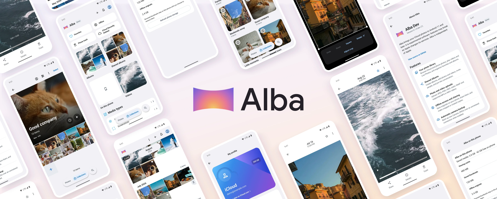

Your iCloud photos, on Android.

Alba is free and open source, with optional donations. No subscriptions or paid features.

**Still experimental.** It uses unofficial Apple APIs, so things can break when Apple changes them. Not affiliated with Apple.

Android 11+. English and Italian. Android application ID: `me.lvca.alba`.

## Features

- [x] Sign in to iCloud with two-factor authentication
- [x] Browse your iCloud photos and the photos on your phone
- [x] Watch videos and Live Photos
- [x] Search by filename, filter by date, and sort your library
- [x] Use albums, favorites and Shared Albums
- [x] Crop and rotate photos, then save an edited copy
- [x] Save originals offline or to your phone, and share them with other apps
- [x] Upload JPEG, PNG, HEIC, static WebP and H.264/HEVC videos in MP4 or MOV files
- [x] Automatically back up new JPEG photos from your camera over an unmetered connection

## Next

- [ ] Automatic backup for videos and more photo formats
- [ ] Choose which folders to back up
- [ ] Include older photos in backups, with a size estimate before starting
- [ ] Play Store release

iCloud Shared Photo Library isn't supported. It's different from Shared Albums, which are supported.

## How it works

Alba talks directly to Apple using the web APIs behind iCloud. Your photos don't pass through an Alba server.

It keeps a local catalog and downloaded previews on your phone, so you can still browse those when you're offline. Full-size originals are downloaded when you need them. You can also choose to keep them offline.

Your password and verification codes aren't saved. Your sign-in session is stored encrypted on your phone. See [Privacy](PRIVACY.md) for the details, including optional crash reporting.

## Try the demo

Choose **Try the demo** on the welcome screen; no Apple Account is needed. Browse the bundled library, albums, videos and editor. Library refresh reads the sample catalog locally.

Open the profile icon, then **Automatic JPEG backup → Try sample backup** to walk through consent, queue progress and completion. The backup walkthrough is simulated: it never reads phone photos, requests photo permissions or uploads to Apple. Use the interruption and Wi-Fi controls to pause and resume it, then preview freeing space with imaginary copies (no real files are deleted). Stop and restart it to repeat; its state resets when leaving demo mode or restarting the app. Real iCloud authentication, transfers and remote verification still require an Apple Account.

The **+** button can add a bundled sample or a selected photo/video to the demo library. Android’s **Share to Alba** and **Open with Alba** screens can also import into demo after confirmation. Selected bytes are retained in private temporary storage, never uploaded, and cleared on the next app process start. Shared albums support real sample-state changes: accepting/declining incoming invitations, approving/denying requests, selecting a cover, contributing selected media, and saving a shared copy to the sample personal library. Demo sharing screens label all people, invitations and nonfunctional public URLs as samples; no invitations are sent or links published.

## Build

Use JDK 21 and Android SDK 37 with build tools 37.0.0. Set `JAVA_HOME` and `ANDROID_SDK_ROOT`, then run:

```sh
./gradlew :app:assembleDebug testDebugUnitTest lintDebug
```

APKs are in `app/build/outputs/apk/`. `:app:assembleRelease` always produces an unsigned release. Official bundles are signed in an isolated GitHub Actions job; see [RELEASING.md](RELEASING.md).

Shared Android settings (SDK levels, Java 17, managed test devices) live in the convention plugins under `build-logic/`.

### Static analysis

CI runs ktlint and detekt on every module:

```sh
./gradlew ktlintCheck detekt
```

ktlint rules are configured in `.editorconfig` and detekt overrides in `config/detekt/detekt.yml`. The code is ktlint-clean; `./gradlew ktlintFormat` fixes most findings. Detekt findings that predate the checks are recorded per module in `detekt-baseline.xml`, so only new findings fail the build. Fix old findings rather than adding new ones; after a deliberate cleanup, regenerate the baselines with:

```sh
./gradlew detektBaseline
```

Reports are written to `<module>/build/reports/detekt/` and `<module>/build/reports/ktlint/`.

JavaScript tools use the Node 26 version pinned in `.nvmrc`. Run `nvm install` and `nvm use` from the repository root before using website, screenshot or release scripts. Script checks: `node --test 'scripts/**/*.test.mjs'`. Bun is used to install the website and screenshot packages from their lockfiles.

## Releases

The website deploys from `main`. App versions are prepared in GitHub Actions, tested internally, then promoted without rebuilding. See [release instructions](RELEASING.md).

## Testing

Tests run at the lowest layer that can show the behaviour:

| Layer | Where | What belongs there |
| --- | --- | --- |
| Plain JVM | `*/src/test` | Logic, state machines, gesture and layout maths, protocol and catalog code. |
| Robolectric UI | `app/src/test` | A screen or component rendered from fixed state with `setAlbaContent` / `testAlbaActions`: what it shows, what each control calls, dialogs, sheets and restoration. Whole-app journeys (navigation, the viewer's gestures, albums, shared albums, the demo's uploads and backup) run the real app through `AlbaAppRule`, with the demo catalog loaded before the test starts. |
| Screenshot goldens | `app/src/test/.../screenshots`, images in `app/src/test/screenshots` | How the main states look on a standard and a compact phone, a wide window, dark theme and font scale 1.3 (Roborazzi). |
| Device | `*/src/androidTest` | What only a device shows: video decoding, MediaStore and the system trash dialog, intents and link routing, WorkManager and jobs, the Keystore, locale changes, real system bars and rendering. |

Before you push, run the JVM layers and the checks. They take a few minutes with a warm Gradle daemon:

```sh
./gradlew testDebugUnitTest lintDebug detekt ktlintCheck
```

Run device tests only when your change touches device-only behaviour, and only the classes it affects. Create a native Android emulator in Android Studio, then pass the classes, comma-separated:

```sh
ALBA_AVD_NAME=your_avd scripts/run_android_tests.sh :app:connectedDebugAndroidTest \
  -Pandroid.testInstrumentationRunnerArguments.class=me.lvca.alba.app.viewer.ViewerTest,me.lvca.alba.app.albums.AlbumsTest
```

Add `#methodName` to a class to run one test, or pass `-Pandroid.testInstrumentationRunnerArguments.annotation=me.lvca.alba.app.testing.Smoke` for the smoke tests, a fast subset with one test per area of device-only behaviour. With no arguments, the script runs every suite. On a Mac, it requires and checks hardware graphics.

### What CI runs

- **Every pull request and push to `main`:** one job builds everything, runs every JVM test, verifies the screenshot goldens, and runs lint, detekt and ktlint. Another runs every app, engine and protocol device test on a Pixel 9 emulator (API 36). Failed device tests are retried once; a test that passes only on the retry is listed as flaky in the job summary. Fix it at the root.
- **Nightly:** the JVM job and the `@Smoke` device tests on API 30 (the minimum) and on a compact phone. Manual runs do both and the full Pixel 9 suite.

"Android checks" passes only when the JVM job and every device job pass.

A device test that does not need a device is in the wrong layer. Mark a new device test `@Smoke` when it is the quickest check of an area of device-only behaviour; CI runs every device test on pull requests either way.

### Screenshot goldens

Text rendering differs between macOS and Linux, so goldens are recorded and verified on Linux, in CI. A local `testDebugUnitTest` renders every state but neither writes nor compares images.

When a change alters how a screen looks, CI's JVM job fails and its `screenshots` artifact holds the new images and their differences from the goldens. Review them, then record the new goldens on your branch: in GitHub, open Actions > CI > Run workflow, pick the branch and tick "record-screenshots". That run records every golden and pushes them to the branch as the repository's GitHub App, so the push starts CI on the branch like any other. The App's ID and private key are the repository secrets `ALBA_BOT_APP_ID` and `ALBA_BOT_PRIVATE_KEY`; without them the run fails and names the missing secret.

To look at the images locally, `./gradlew :app:testDebugUnitTest --tests '*Screenshots' -Proborazzi.test.record=true` writes them to `app/src/test/screenshots`. Do not commit images recorded on a Mac.

### Store and README screenshots

Store artwork stays a device capture, because it should show real hardware rendering of the demo photos. Tests that capture it carry `@ScreenshotCapture` and run only when asked for:

```sh
ALBA_AVD_NAME=your_avd scripts/run_android_tests.sh :app:connectedDebugAndroidTest \
  -Pandroid.testInstrumentationRunnerArguments.annotation=me.lvca.alba.app.testing.ScreenshotCapture \
  -Pandroid.testInstrumentationRunnerArguments.class=me.lvca.alba.app.viewer.ViewerTest
```

The full steps are in [the screenshot tool](tools/store-screenshots/README.md).

### Performance

For performance work, set `ANDROID_SERIAL` to your test device. Run `scripts/benchmark_android.sh profile` to update the Baseline Profile, then `scripts/benchmark_android.sh measure` on a physical phone. These use a separate app with demo photos. The older emulator measurement script is only a smoke check.

## Contribute

Found a bug or have an idea? [Open an issue](https://github.com/thisislvca/alba/issues). Pull requests are welcome too, under the same AGPL-3.0-only license.

Please leave passwords, account data and personal photos out of reports. For security problems, use [private reporting](SECURITY.md).

## License

[AGPL-3.0-only](LICENSE). See [third-party credits and licenses](THIRD_PARTY_NOTICES.md).
